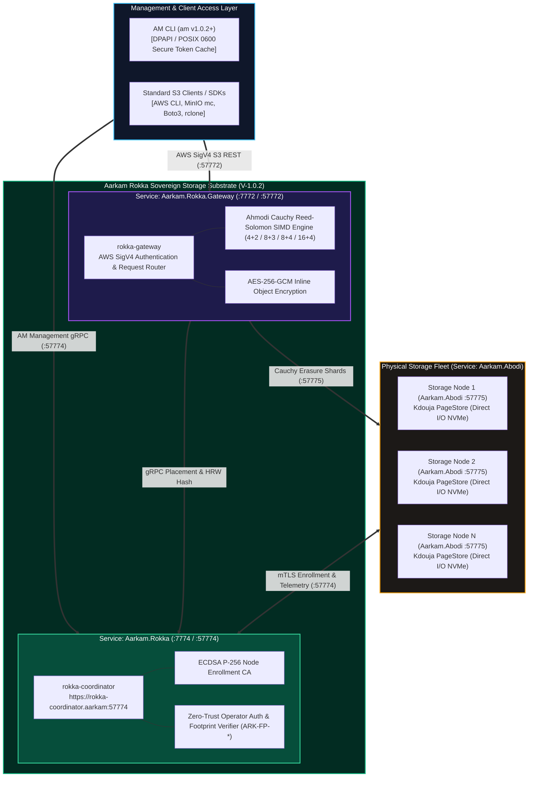

# Rokka Sovereign Storage Engine — Standalone Installation & Activation Guide
# Official Production Air-Gapped Deployment Guide (Version 1.0.2-GA)

| Specification | Details |
| :--- | :--- |
| **Document Identifier** | `ARK-ROKKA-INSTALL-V1.0.2` |
| **Product** | Aarkam Rokka Sovereign Storage Engine (`rokka-coordinator` & `rokka-gateway`) |
| **Standardized Service Names** | **`Aarkam.Rokka`** (Coordinator) & **`Aarkam.Rokka.Gateway`** (Gateway) |
| **Release Version** | `v1.0.2-GA (V-1.0.2, Production Stable)` |
| **Default Coordinator Endpoint** | **`https://rokka-coordinator.aarkam:57774`** (`:57774` HTTPS/mTLS, `:7774` gRPC) |
| **Default Gateway Endpoint** | **`https://rokka-gateway.aarkam:57772`** (`:57772` HTTPS, `:7772` HTTP) |
| **Customer Portal (AarkamCP)** | **[https://aarkam.io/Administration/Auth/Login](https://aarkam.io/Administration/Auth/Login)** |
| **Compliance Level** | Saudi NCA ECC-2:2024, NCA CSCC-1:2023, FIPS 140-3 Zero-Trust Architecture |
| **Target Distribution** | Zero-Egress Air-Gapped Datacenters (Linux `x86_64`, Windows Server `x64`, OCI Container) |

---

## 1. System Overview & Sovereign Ecosystem Service Structure

The **Aarkam Rokka Sovereign Storage Engine (`v1.0.2-GA`)** provides an autonomous, enterprise-grade, high-performance object and key-value storage fabric designed for air-gapped sovereign environments (zero telemetry, zero external cloud callbacks).

All services follow the standardized **Aarkam V2** service naming structure across Windows Server Services and Linux `systemd` units:

| Service Name | Binary / Daemon | Default Ports | Role in Aarkam V2 Fabric |
| :--- | :--- | :---: | :--- |
| **`Aarkam.Rokka`** | `rokka-coordinator` | **`57774`** (HTTPS/mTLS)<br/>**`7774`** (gRPC HTTP/2) | Stateless Control Plane, Raft MON Quorum, HRW Placement, Node Enrollment CA & Genesis License Verifier |
| **`Aarkam.Rokka.Gateway`** | `rokka-gateway` | **`57772`** (HTTPS S3)<br/>**`7772`** (HTTP S3) | Line-Rate AWS SigV4 S3 REST Gateway, AES-256-GCM Envelope Encryption & Ahmodi SIMD Cauchy Reed-Solomon (`4+2`, `8+3`, `8+4`, `16+4`) |
| **`Aarkam.Abodi`** | `Abodi` (`v1.0.3+`) | **`57775`** (gRPC mTLS)<br/>**`57776`** (HTTPS REST) | Storage Node Gateway, Dual-Mode Kdouja SAT Substrate & Predictive SMART Hardware Telemetry Agent |
| **`Aarkam.Kdouja`** | `kdoujad` (`v1.0.2`) | **`57771`** (gRPC) | LSM-Tree Metadata Engine & Unbuffered Direct I/O (`O_DIRECT`) Block PageStore (`Aarkam.Kdouja.SDK v1.0.1`) |



---

## 2. Default Installation Ports & Custom Endpoint Resolution

By default, if the operator does not specify a custom port or URL during installation:
- **Rokka Coordinator (`Aarkam.Rokka`)** defaults to:
  ```text
  https://rokka-coordinator.aarkam:57774
  ```
  *(with internal HTTP/2 gRPC and `/health` probe on port `7774`)*.
- **Rokka Gateway (`Aarkam.Rokka.Gateway`)** defaults to:
  ```text
  https://rokka-gateway.aarkam:57772
  ```
  *(with HTTP S3 and `/health` probe on port `7772`)*.

### Customizing Ports or URLs (Optional)
- **Default Installation (Recommended Sovereign Standard):**
  - Windows: `.\install-rokka.ps1` -> Binds Coordinator HTTPS to `57774` (`https://rokka-coordinator.aarkam:57774`).
  - Linux: `sudo ./install-rokka.sh` -> Binds Coordinator HTTPS to `57774` (`https://rokka-coordinator.aarkam:57774`).
- **Custom Port or On-Premises IP / FQDN:**
  - Pass `-RokkaUrl "https://10.20.0.10:57774"` (or `-CoordinatorHttpsPort 58443`) on Windows, or `--rokka-url "https://10.20.0.10:57774"` (or `--coordinator-https-port 58443`) on Linux.
  - If port `443` is specified (`-CoordinatorHttpsPort 443` / `--coordinator-https-port 443`), the endpoint automatically omits the port suffix (`https://rokka-coordinator.aarkam`).

---

## 3. Zero-Trust Security, PKI & Cryptographic Keys (CWE-312)

Under Saudi NCA ECC-2:2024 (§2-1-3) and FIPS 140-3 Zero-Trust compliance, **cryptographic keys are never stored in plaintext JSON configuration files**. The installer automatically provisions and injects 256-bit keys into the OS environment (Windows Machine Environment Variables or `/etc/rokka/rokka.env` with `0600` permissions on Linux) and bootstraps the ECDSA P-256 Cluster Root CA (`ca.pfx` / `ca.crt`):

| Secret / Artifact | Environment Variable / Path | Purpose |
| :--- | :--- | :--- |
| **Master Key** | `ROKKA_MASTER_KEY` | 64-character hex (256-bit AES) cluster master encryption key for per-chunk AES-256-GCM envelope keys. |
| **WAL Encryption Key** | `ROKKA_WAL_ENCRYPTION_KEY` | 64-character hex key encrypting Kdouja LSM write-ahead logs on disk. |
| **Cluster CA Passphrase** | `ROKKA_CLUSTER_CA_PASSWORD` | Cryptographic passphrase protecting the internal ECDSA P-256 Cluster Root CA (`ca.pfx`). |
| **Raft & JWT Secret** | `ROKKA_CLUSTER_SECRET` | 64-character hex secret authenticating Raft quorum messages and local operator JWT tokens. |
| **S3 Admin Access Key** | `ROKKA_ACCESS_KEY_ID` | Default: `rokka_admin`. Root S3 account identity for `Aarkam.Rokka.Gateway`. |
| **S3 Admin Secret Key** | `ROKKA_SECRET_ACCESS_KEY` | Defaults to `ROKKA_MASTER_KEY` unless customized. |

> [!IMPORTANT]
> **Disaster Recovery Requirement:** Immediately back up `ROKKA_MASTER_KEY`, `ROKKA_WAL_ENCRYPTION_KEY`, and `ROKKA_CLUSTER_CA_PASSWORD` printed at the end of installation into your enterprise secret vault.

---

## 4. Windows Server Deployment (`install-rokka.ps1`)

### Step 1: Unpack Release Package
```powershell
Expand-Archive -Path "rokka-v1.0.2-win-x64.zip" -DestinationPath "C:\Setup\Rokka" -Force
Set-Location "C:\Setup\Rokka"
```

### Step 2: Run Pre-Flight Check (Optional)
```powershell
.\install-rokka.ps1 -CheckOnly
```

### Step 3: Execute Automated Production Installer
Open PowerShell as **Administrator** and run:
```powershell
# Default installation (Rokka Coordinator: https://rokka-coordinator.aarkam:57774)
.\install-rokka.ps1

# Or with an explicit ClusterCode and custom Coordinator URL:
.\install-rokka.ps1 -ClusterCode "ARK-PROD-RYD-01" -RokkaUrl "https://rokka-coordinator.aarkam:57774"
```

### Step 4: Verify Windows Services (`Aarkam.Rokka` & `Aarkam.Rokka.Gateway`)
```powershell
Get-Service -Name "Aarkam.Rokka", "Aarkam.Rokka.Gateway"
rokka-coordinator --version
rokka-gateway --version
curl.exe -s http://127.0.0.1:7774/health
curl.exe -s http://127.0.0.1:7772/health
```

---

## 5. Linux Deployment (`install-rokka.sh`)

### Step 1: Unpack Release Package
```bash
sudo mkdir -p /tmp/rokka-setup
sudo unzip rokka-v1.0.2-linux-x64.zip -d /tmp/rokka-setup
cd /tmp/rokka-setup
sudo chmod +x install-rokka.sh rokka-coordinator rokka-gateway
```

### Step 2: Run Pre-Flight Check (Optional)
```bash
sudo ./install-rokka.sh --check-only
```

### Step 3: Execute Automated Production Installer
```bash
# Default installation (Rokka Coordinator: https://rokka-coordinator.aarkam:57774)
sudo ./install-rokka.sh

# Or with an explicit ClusterCode and custom Coordinator URL:
sudo ./install-rokka.sh --cluster-code "ARK-PROD-RYD-01" --rokka-url "https://rokka-coordinator.aarkam:57774"
```

### Step 4: Verify `systemd` Services (`Aarkam.Rokka` & `Aarkam.Rokka.Gateway`)
```bash
sudo systemctl status Aarkam.Rokka Aarkam.Rokka.Gateway
curl -s http://127.0.0.1:7774/health
curl -s http://127.0.0.1:7772/health
```

---

## 6. Rokka Cluster Activation & Sovereign Genesis Ceremony

Because Rokka ships with **zero default operator passwords and zero cloud callbacks**, activating a newly installed Rokka cluster requires binding its deterministic **Rokka Coordinator Footprint (`ARK-FP-...`)** on the **Aarkam Customer Portal (AarkamCP)** and applying the signed **Sovereign Genesis Bundle (`.arkbundle`)**.

### 6.1 Required Activation Information (Printed Automatically by Installer)
At the end of `install-rokka.ps1` and `install-rokka.sh`, the installer outputs a dedicated **ROKKA CLUSTER ACTIVATION & SOVEREIGN GENESIS CEREMONY INFORMATION** block containing:

1. **AarkamCP (Customer Portal) Url:** `https://aarkam.io/Administration/Auth/Login`
2. **AarkamCP Subscription Portal:** `https://aarkam.io/Administration/CurrentSubscription`
3. **Rokka Coordinator Footprint:** `ARK-FP-XXXXXXXX-XXXXXXXX-XXXXXXXX` *(Deterministic HMAC-SHA256 hardware signature across Hostname, CPU Count, Architecture, System Machine ID, and Primary Physical MAC)*
4. **Cluster Code:** `XXXX-XXXX-XXXXX` *(e.g. `ARK-PROD-RYD-01` or auto-generated 15-character code)*
5. **Rokka Coordinator Endpoint:** `https://rokka-coordinator.aarkam:57774`
6. **Rokka Gateway Endpoint:** `https://rokka-gateway.aarkam:57772`
7. **Cryptographic Recovery Keys:** `ROKKA_MASTER_KEY`, `ROKKA_WAL_ENCRYPTION_KEY`, `ROKKA_CLUSTER_CA_PASSWORD`, `ROKKA_CLUSTER_SECRET`

### 6.2 Step-by-Step Activation Workflow

#### Step 1: Bind Rokka Coordinator Footprint on AarkamCP
1. Open your browser and sign in to **AarkamCP**:
   ```text
   https://aarkam.io/Administration/Auth/Login
   ```
2. Navigate to **Administration -> Current Subscription**:
   ```text
   https://aarkam.io/Administration/CurrentSubscription
   ```
3. On your active subscription card, click **"Bind Cluster Fingerprint"**:
   - **Cluster Fingerprint:** Paste the `Rokka Coordinator Footprint` (`ARK-FP-...`) printed by the installer (or retrieved via `am cluster fingerprint`).
   - **Cluster Code:** Enter the `Cluster Code` printed by the installer.
   - Click **Save Binding** *(Note: Hardware fingerprint binding is immutable once locked)*.
4. Click **"Manage Operators"** and add your authorized enterprise operators:
   - Assign RBAC roles (`ClusterAdmin`, `StorageOperator`, `SecurityOfficer`, `Auditor`) and initial passwords (hashed in-memory via PBKDF2-HMAC-SHA512, 600,000 iterations).
5. Click **"Download Sovereign Genesis Bundle (.arkbundle)"** and transfer the `.arkbundle` file across your air-gap boundary to the Rokka Coordinator host.

#### Step 2: Inspect & Apply Genesis Bundle Offline via AM CLI
```bash
# 1. Point AM CLI to Rokka Coordinator
am config set --endpoint "https://rokka-coordinator.aarkam:57774"

# 2. Verify local Rokka Coordinator Footprint
am cluster fingerprint

# 3. Pre-flight offline inspection of RSA-4096-PSS signature & Hardware Lock (must show MATCH)
am license inspect --bundle ./<your-license-key>.arkbundle

# 4. Ingest Genesis Bundle into Aarkam.Rokka Coordinator (provisions operators & seals quotas)
am license apply --bundle ./<your-license-key>.arkbundle

# 5. Authenticate operator session offline
am auth login -u <operator-username> -p "<operator-password>"
am auth whoami
```

---

## 7. Connecting `Aarkam.Abodi` Storage Nodes to Rokka

Once `Aarkam.Rokka` is activated, enroll your physical storage nodes running **`Aarkam.Abodi` (`v1.0.3+`)**:

1. **Generate Single-Use Node Enrollment Token (`ET1.<hex>`) via AM CLI:**
   ```bash
   am node token create --node-code "NODE-01" --tier "SAT"
   ```

2. **Install `Aarkam.Abodi` on Each Physical Storage Host:**
   - **Linux (`Aarkam.Abodi.service`):**
     ```bash
     sudo ./install-abodi.sh \
       --node-code "NODE-01" \
       --rokka-url "https://rokka-coordinator.aarkam:57774" \
       --enrollment-token "<ET1.TOKEN_FROM_AM>" \
       --storage-dir "/var/lib/rokka/storage"
     ```
   - **Windows (`Aarkam.Abodi`):**
     ```powershell
     .\install-abodi.ps1 `
       -NodeCode "NODE-01" `
       -RokkaUrl "https://rokka-coordinator.aarkam:57774" `
       -EnrollmentToken "<ET1.TOKEN_FROM_AM>" `
       -StorageDir "D:\rokka_storage"
     ```

3. **Verify Storage Fleet & S3 Bucket Operations:**
   ```bash
   am cluster status
   am node list
   am s3 config set --endpoint "https://rokka-gateway.aarkam:57772" --access-key "rokka_admin" --secret-key "<ROKKA_MASTER_KEY>"
   am s3 mb s3://sovereign-vault --policy 4+2
   am s3 ls
   ```
