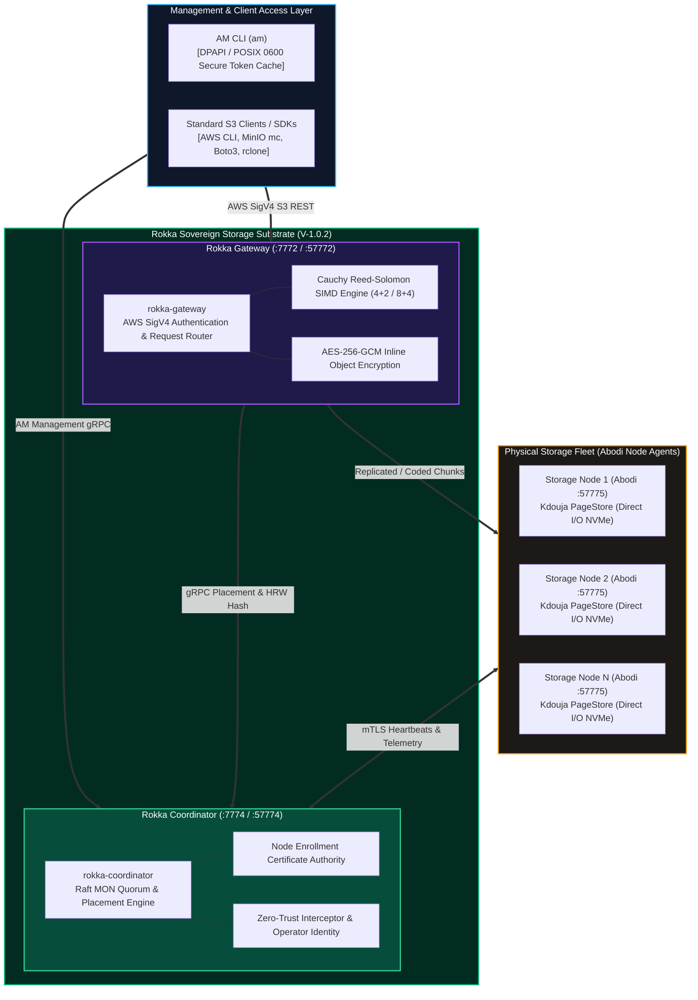

# Rokka Sovereign Storage Engine — Standalone Installation Guide
# Official Production Air-Gapped Deployment Guide (Version 1.0.2-GA)

| Specification | Details |
| :--- | :--- |
| **Document Identifier** | `ARK-ROKKA-INSTALL-V1.0.2` |
| **Product** | Rokka Sovereign Storage Engine (`rokka-coordinator` & `rokka-gateway`) |
| **Release Version** | `V-1.0.2-GA (Production Stable)` |
| **Architectural Scope** | Standalone Sovereign Storage Substrate (Control Plane & S3 REST Data Gateway) |
| **Target Audience** | Datacenter Storage Engineers, Infrastructure Administrators, Defense Systems Engineers |
| **Compliance Level** | Saudi NCA ECC-2:2024, NCA CSCC-1:2023, FIPS 140-3 Zero-Trust Architecture |
| **Target Distribution** | Zero-Egress Air-Gapped Datacenters (Linux x64, Windows Server x64, OCI Container) |

---

## 1. System Overview & Sovereign Ecosystem Architecture

The **Rokka Sovereign Storage Engine** provides an autonomous, enterprise-grade, high-performance object and key-value storage fabric designed specifically for air-gapped sovereign environments where external connectivity is strictly prohibited (zero telemetry, zero cloud callbacks).

Rokka forms the core substrate of the Aarkam ecosystem and operates in tight integration with **Abodi** and **AM CLI**:



### Ecosystem Roles & Interconnections:
1. **`rokka-coordinator`**: Stateless control plane, Raft MON consensus quorum, dynamic Highest Random Weight (HRW) placement, and internal mTLS Node Enrollment Certificate Authority.
2. **`rokka-gateway`**: Line-rate AWS SigV4 compatible S3 REST gateway with SIMD-accelerated Cauchy Reed-Solomon erasure coding and inline AES-256-GCM envelope encryption.
3. **`abodi`**: Physical storage node daemon installed on each storage server. Enrolls with Coordinator via `https://rokka-coordinator.aarkam:57774` and serves Cauchy chunks directly to/from physical NVMe/SSD media.
4. **`am` (AM CLI)**: Unified fabric management CLI used to configure Rokka, generate Abodi node enrollment tokens, inspect health, and manage S3 buckets.

---

## 2. Standardized Sovereign Endpoint Matrix

| Daemon | Port | Protocol | Sovereign DNS URL | Description |
| :--- | :--- | :--- | :--- | :--- |
| **`rokka-coordinator`** | `7774` | HTTP/2 Cleartext | `http://rokka-coordinator.aarkam:7774` | Internal gRPC & Health Probe (`/health`) |
| **`rokka-coordinator`** | `57774` (or `443`) | HTTPS / mTLS | `https://rokka-coordinator.aarkam:57774`<br/>`https://rokka-coordinator.aarkam` | Sovereign Control Plane, Raft Quorum, & Node Enrollment |
| **`rokka-gateway`** | `7772` | HTTP REST | `http://rokka-gateway.aarkam:7772` | High-Throughput S3 REST API (Local/VPC Ingestion) |
| **`rokka-gateway`** | `57772` (or `443`) | HTTPS REST | `https://rokka-gateway.aarkam:57772`<br/>`https://rokka-gateway.aarkam` | Secure S3 REST API (SigV4 TLS Ingestion) |

---

## 3. Zero-Trust Security & Key Architecture (CWE-312)

Under sovereign zero-trust compliance (NCA ECC-2:2024 / FIPS 140-3), **cryptographic keys are never stored in plaintext configuration files**. All secrets are injected exclusively through system environment variables:

| Secret Name | Environment Variable | Purpose |
| :--- | :--- | :--- |
| **Master Key** | `ROKKA_MASTER_KEY` | 64-character hex (256-bit AES) cluster encryption key. |
| **WAL Encryption Key** | `ROKKA_WAL_ENCRYPTION_KEY` | 64-character hex key encrypting Kdouja LSM write-ahead logs on disk. |
| **S3 Admin Access Key** | `ROKKA_ACCESS_KEY_ID` | Default: `rokka_admin`. Admin account identity for S3 REST operations. |
| **S3 Admin Secret Key** | `ROKKA_SECRET_ACCESS_KEY` | Resolved automatically from `ROKKA_MASTER_KEY` if not explicitly customized. |
| **Cluster CA Passphrase**| `ROKKA_CLUSTER_CA_PASSWORD` | Cryptographic passphrase protecting internal mTLS root CA private key. |

> [!IMPORTANT]
> **Disaster Recovery Requirement**: The installer automatically generates cryptographically random 256-bit keys and sets them in the server's environment. You **must immediately backup `ROKKA_MASTER_KEY`** in your enterprise vault. If the machine is re-imaged or migrated, this key is required to decrypt cluster storage and metadata.

---

## 4. Binary Package Download (GitHub Releases)

Official standalone binaries and air-gapped installation bundles are distributed via [GitHub Releases (v1.0.2)](https://github.com/aarkamio/Aarkam/releases/tag/v1.0.2).

| Platform | Package Asset | Download Link |
| :--- | :--- | :--- |
| **Linux (x64)** | `rokka-v1.0.2-linux-x64.zip` | [Download from GitHub](https://github.com/aarkamio/Aarkam/releases/download/v1.0.2/rokka-v1.0.2-linux-x64.zip) |
| **Windows (x64)** | `rokka-v1.0.2-win-x64.zip` | [Download from GitHub](https://github.com/aarkamio/Aarkam/releases/download/v1.0.2/rokka-v1.0.2-win-x64.zip) |
| **Linux Coordinator (Standalone)** | `rokka-coordinator-v1.0.2-linux-x64.zip` | [Download from GitHub](https://github.com/aarkamio/Aarkam/releases/download/v1.0.2/rokka-coordinator-v1.0.2-linux-x64.zip) |
| **Linux Gateway (Standalone)** | `rokka-gateway-v1.0.2-linux-x64.zip` | [Download from GitHub](https://github.com/aarkamio/Aarkam/releases/download/v1.0.2/rokka-gateway-v1.0.2-linux-x64.zip) |

---

## 5. Windows Server Deployment (Automated PowerShell)

1. Download and unpack `rokka-v1.0.2-win-x64.zip`:
   ```powershell
   Invoke-WebRequest -Uri "https://github.com/aarkamio/Aarkam/releases/download/v1.0.2/rokka-v1.0.2-win-x64.zip" -OutFile "rokka-v1.0.2-win-x64.zip"
   Expand-Archive -Path "rokka-v1.0.2-win-x64.zip" -DestinationPath "."
   cd rokka-v1.0.2-win-x64
   ```
2. Open PowerShell as **Administrator** and run:
   ```powershell
   .\install-rokka.ps1 -StartServices
   ```
3. Verify daemons:
   ```powershell
   Get-Service -Name "Rokka.Coordinator", "Rokka.Gateway"
   rokka-coordinator --version
   rokka-gateway --version
   curl.exe -k http://localhost:7774/health
   curl.exe -k http://localhost:7772/health
   ```

---

## 6. Linux Deployment (Automated systemd)

1. Download and unpack `rokka-v1.0.2-linux-x64.zip`:
   ```bash
   curl -fSL -o rokka-v1.0.2-linux-x64.zip "https://github.com/aarkamio/Aarkam/releases/download/v1.0.2/rokka-v1.0.2-linux-x64.zip"
   unzip rokka-v1.0.2-linux-x64.zip
   cd rokka-v1.0.2-linux-x64
   ```
2. Run installer as root:
   ```bash
   sudo ./install-rokka.sh --start-services
   ```
3. Verify systemd services:
   ```bash
   sudo systemctl status rokka-coordinator rokka-gateway
   curl -s http://localhost:7774/health
   curl -s http://localhost:7772/health
   ```

---

## 7. Connecting Abodi Storage Nodes to Rokka

After installing Rokka, deploy **Abodi** on each physical storage host:

1. **Obtain Node Enrollment Token** (using AM CLI):
   ```bash
   am node token create --node-code "NODE-01" --tier "SAT"
   ```

2. **Install Abodi on the Physical Storage Host**:
   - **Linux**:
     ```bash
     sudo /opt/rokka/abodi/install-abodi.sh \
       --node-code "NODE-01" \
       --rokka-url "https://rokka-coordinator.aarkam:57774" \
       --enrollment-token "<TOKEN_FROM_AM>" \
       --storage-dir "/var/lib/rokka/storage"
     ```
   - **Windows**:
     ```powershell
     .\install-abodi.ps1 `
       -NodeCode "NODE-01" `
       -RokkaUrl "https://rokka-coordinator.aarkam:57774" `
       -EnrollmentToken "<TOKEN_FROM_AM>" `
       -StorageDir "D:\Rokka\Storage" `
       -StartService
     ```

> [!TIP]
> If using standard port 443 with an internal load balancer or DNS reverse proxy, pass `--rokka-url "https://rokka-coordinator.aarkam"`. On-premises IP addresses are also fully supported (e.g. `--rokka-url "https://10.20.0.10:57774"`).

---

## 7. Managing Rokka with AM CLI

```bash
# 1. Point AM to Rokka Coordinator
am config set --endpoint "https://rokka-coordinator.aarkam:57774"

# 2. Login as Administrator
am auth login --username admin --password <PASSWORD>

# 3. Verify Cluster Health & Storage Fleet
am cluster status
am node list

# 4. Configure S3 & Create Bucket
am s3 config set --endpoint "https://rokka-gateway.aarkam:57772" --access-key "rokka_admin" --secret-key "<ROKKA_MASTER_KEY>"
am s3 mb s3://sovereign-vault --policy 4+2
am s3 ls
```
